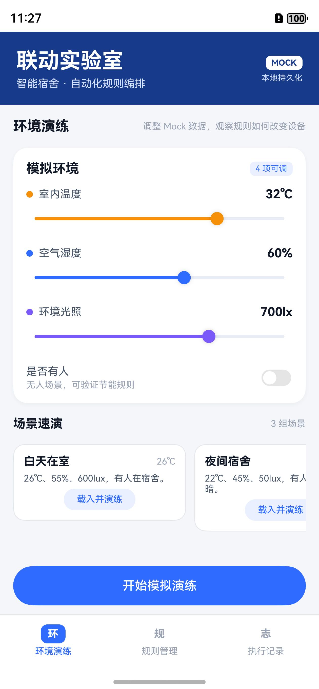
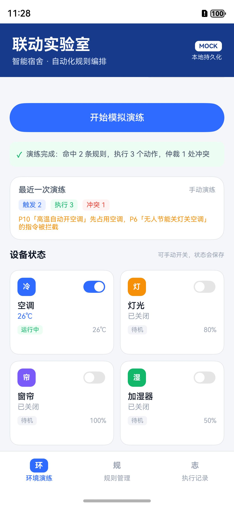
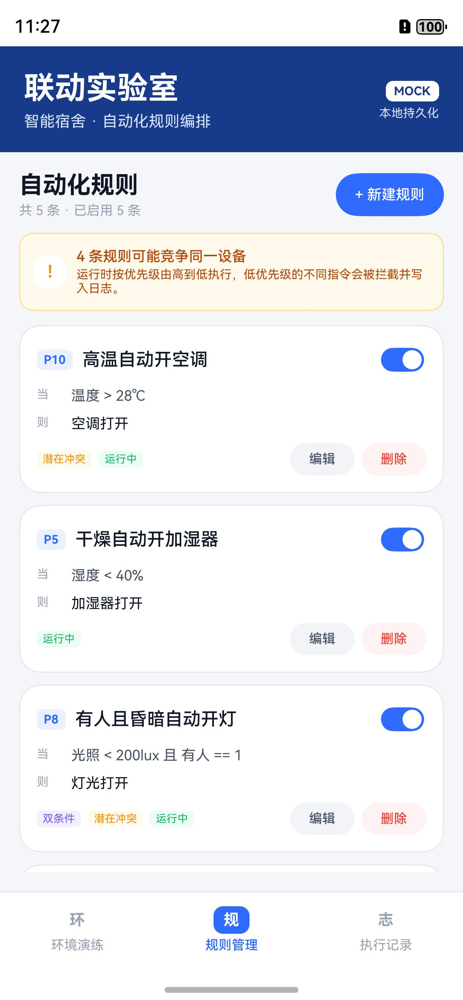
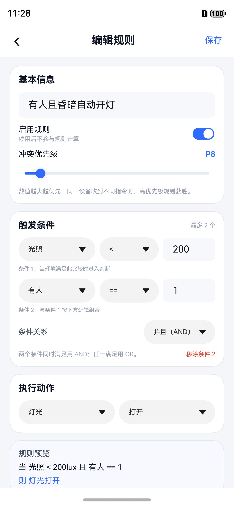
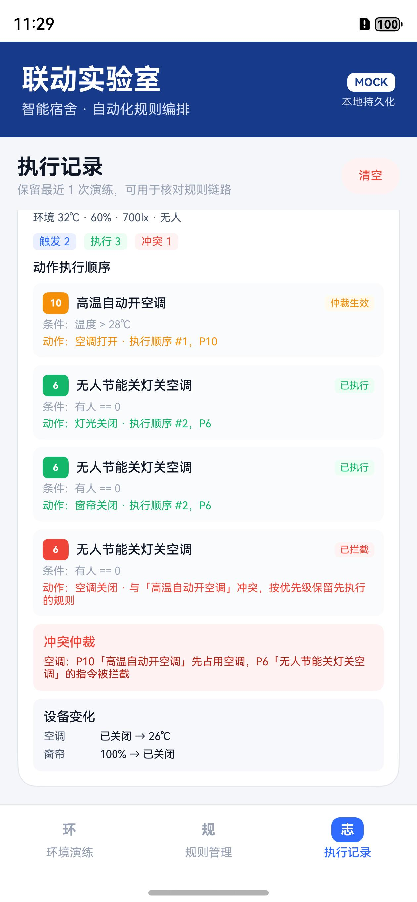

# 联动实验室 · 智能宿舍自动化规则编排 App

> 《鸿蒙高级应用开发工程师认证》期末大作业 · 主题三：联动实验室
>
> 作者：任树山（学号 20230313214） · GitHub 账号：`3298514313`
>
> GitHub 仓库：[https://github.com/3298514313/Qimo](https://github.com/3298514313/Qimo)

## 一、项目简介

“联动实验室”面向智能宿舍管理，允许学生设计“当环境满足条件时，自动执行设备动作”的联动规则，并用 Mock 环境检验效果。应用不依赖真实硬件或云平台，全部环境、设备和规则均在本地模拟。

完整体验链路：

**创建规则 → 调整 Mock 环境 → 运行联动 → 观察设备变化与执行顺序 → 发现冲突并调整优先级 → 退出重启恢复规则、设备、环境、场景和记录。**

默认数据包含 5 条规则、4 类设备、4 项环境指标和 3 组演练场景；“无人高温”场景可直接观察 `P10 高温开空调` 与 `P6 无人节能关空调` 的冲突仲裁。

## 二、题目要求对照

| 题目要求 | 本项目实现 | 主要代码 |
| --- | --- | --- |
| 至少 4 类可控制设备 | 空调、灯光、窗帘、加湿器 | `model/Types.ets`、`common/Labels.ets` |
| 至少 3 项可调整模拟环境数据 | 温度、湿度、光照、是否有人（4 项） | `pages/EnvPanel.ets` |
| 支持新增/修改/启停至少 4 条规则 | 默认 5 条；支持新增、编辑、启停、删除 | `pages/RulePanel.ets`、`pages/RuleEdit.ets`、`viewmodel/AppViewModel.ets` |
| 至少 1 条由两个条件共同决定的规则 | “有人且昏暗自动开灯”为 `光照 < 200 AND 有人 == 1`；“光照充足自动关灯”为双条件 | `mock/MockData.ets` |
| 规则引擎按实际输入计算 | 逐条计算 AND / OR 条件，真实改变设备状态 | `engine/RuleEngine.ets` |
| 记录触发条件、设备变化、执行顺序 | 日志含条件快照、动作、优先级、顺序、`before/after` 设备快照 | `engine/RuleEngine.ets`、`pages/LogPanel.ets` |
| 冲突控制有顺序/优先级 | 按 `优先级降序 → 创建时间升序 → id 升序` 仲裁；同设备不同指令被拦截 | `engine/RuleEngine.ets` |
| 至少 2 组环境场景演练 | 3 组内置场景 + 自定义场景保存/载入 | `mock/MockData.ets`、`pages/EnvPanel.ets` |
| 规则/设备/场景/记录持久化 | Preferences 保存 `rules/devices/env/scenarios/logs`，启动时恢复 | `store/PreferencesStore.ets`、`viewmodel/AppViewModel.ets` |
| 至少 6 条有效自动化测试 | 17 条 Hypium 用例：12 条规则引擎 + 5 条校验 | `entry/src/ohosTest/ets/test/` |
| 事件通信 | `@kit.BasicServicesKit` emitter 封装事件总线，规则/设备/日志变更通知页面 | `bus/EventBus.ets` |

## 三、开发环境

- HarmonyOS Stage 模型，**API 17（5.0.5）**
- DevEco Studio 5.0.5 及以上
- ArkTS + ArkUI
- `@kit.ArkData` Preferences
- `@kit.BasicServicesKit` emitter
- `@ohos/hypium` 1.0.21

## 四、整体架构

```text
pages/Index (Tabs)
├── pages/EnvPanel      环境调整、场景载入、运行演练、设备开关
├── pages/RulePanel     规则列表、启停、新增、编辑、删除
│   └── pages/RuleEdit  条件/动作/优先级编辑与校验
└── pages/LogPanel      触发条件、执行顺序、冲突、设备前后变化

viewmodel/AppViewModel（单例）
├── engine/RuleEngine           条件匹配、执行排序、冲突仲裁、日志生成
├── store/PreferencesStore      rules/devices/env/scenarios/logs 持久化
├── bus/EventBus                emitter 事件通知
└── mock/MockData               默认规则、设备、环境、场景

common/
├── Types.ets        领域模型
├── Clone.ets        显式深拷贝（ArkTS 严格模式不使用对象展开）
├── Validation.ets   规则与环境校验
└── Labels.ets       中文文案、设备/传感器元数据
```

### 一次演练的数据流

1. `EnvPanel` 通过 `AppViewModel.adjustEnv()` 修改内存环境；
2. 点击“开始模拟演练”后，`AppViewModel.runSimulation()` 调用 `RuleEngine.evaluate()`；
3. 引擎复制设备状态，筛选触发规则，按优先级排序，逐条执行动作；
4. 同一设备已被更高优先级规则占用时，后续不同指令记为 `blocked` 并写入冲突；
5. 生成包含条件快照、动作顺序、设备前后状态的 `LogEntry`；
6. `AppViewModel.persistAll()` 将全部核心数据写入 Preferences；
7. `EventBus` 发出 `DEVICES_CHANGED`、`LOG_PUSHED`，相关页面刷新。

### 冲突仲裁规则

- 排序键：`priority` 降序 → `createdAt` 升序 → `id` 升序。
- 同一设备只允许先执行的规则占用；后续规则：
  - 动作完全一致：合并执行，不记冲突；
  - 动作不同：拦截并写入 `ConflictRecord`（含获胜/被拦截规则名和原因）。
- 这保证同一输入下结果稳定、可复现，而不是依赖数组顺序或时间戳抖动。

### 持久化键

| 键 | 内容 |
| --- | --- |
| `rules` | 规则、条件、动作、优先级 |
| `devices` | 4 类设备的开关和档位 |
| `env` | 当前 Mock 环境 |
| `scenarios` | 内置与自定义场景 |
| `logs` | 最近 30 次执行记录 |

## 五、目录结构

```text
DormLink/
├── AppScope/
├── entry/
│   ├── src/main/
│   │   ├── ets/
│   │   │   ├── entryability/EntryAbility.ets
│   │   │   ├── model/Types.ets
│   │   │   ├── mock/MockData.ets
│   │   │   ├── engine/RuleEngine.ets
│   │   │   ├── store/PreferencesStore.ets
│   │   │   ├── bus/EventBus.ets
│   │   │   ├── common/{Clone,Constants,Labels,Theme,Validation}.ets
│   │   │   ├── viewmodel/AppViewModel.ets
│   │   │   └── pages/{Index,EnvPanel,RulePanel,LogPanel,RuleEdit}.ets
│   │   └── resources/
│   └── src/ohosTest/ets/test/
│       ├── List.test.ets
│       ├── RuleEngine.test.ets
│       └── Validation.test.ets
├── docs/
│   ├── TEST_EVIDENCE.md
│   └── SCREENSHOTS.md
├── build-profile.json5
├── oh-package.json5
└── README.md
```

## 六、运行方法

1. 用 DevEco Studio 打开项目根目录 `DormLink`。
2. 等待 `ohpm install` 与 Sync 完成；SDK 选择 API 17（5.0.5）。
3. 选择手机/平板模拟器或真机，点击 Run。
4. 首次启动如提示签名，使用 DevEco 自动签名即可。
5. 打开“环境演练”，可直接点“夜间宿舍”或“无人高温”的“载入并演练”。

命令行编译（在 DevEco Terminal 中执行）：

```bash
hvigorw assembleHap --mode module -p product=default -p module=entry@default -p buildMode=debug
```

产物默认在 `entry/build/default/outputs/default/`。命令行构建为未签名 HAP，真机安装请用 DevEco 运行或配置签名。

## 七、自动化测试

测试入口：`entry/src/ohosTest/ets/test/List.test.ets`。当前共 **17 条**：

| 编号 | 类型 | 用例 | 预期 |
| --- | --- | --- | --- |
| T01 | 正常 | 温度 30℃ 满足 `>28` | 触发并打开空调 |
| T02 | 边界 | 温度恰好 28℃ | `>` 不触发，`>=` 触发 |
| T03 | 正常 | 双条件 AND | 光照与有人同时满足才触发 |
| T04 | 正常 | OR 逻辑 | 任一条件满足即触发 |
| T05 | 异常 | 禁用/无条件/目标设备缺失 | 不触发，缺失目标记 `blocked` |
| T06 | 冲突 | 高优先级开机 vs 低优先级关机 | 高优先级获胜并记录拦截 |
| T07 | 边界 | 同优先级不同创建时间 | 创建更早者获胜 |
| T08 | 正常 | 两规则下发相同动作 | 合并执行，不产生冲突 |
| T09 | 冲突 | 同设备不同 `setLevel` | 高优先级档位生效 |
| T10 | 正常 | 单规则多个动作 | 设备 before/after 快照正确 |
| T11 | 正常 | 潜在冲突静态检查 | 标记竞争同一设备的规则 |
| T12 | 正常 | 完整规则校验 | 0 条错误 |
| T13 | 异常 | 空名称/空条件/越界优先级 | 返回多条错误 |
| T14 | 边界 | `有人` 条件取 2 | 被拒绝 |
| T15 | 异常 | `setLevel` 缺档位/越界 | 被拒绝 |
| T16 | 异常 | 环境温度/湿度/有人标记越界 | 返回多条错误 |
| T17 | 集成 | 默认“无人高温”场景 | 空调冲突，P10 高温规则获胜 |

运行方式：

1. 在 DevEco Studio 中右键 `entry/src/ohosTest/ets/test/List.test.ets` → Run。
2. 或先编译测试 HAP：

```bash
hvigorw assembleHap --mode module -p product=default -p module=entry@ohosTest -p buildMode=debug
```

3. 通过 DevEco 的 Test 面板在模拟器/真机上执行。

无设备时可先运行纯逻辑验证脚本（实际执行规则引擎与校验的 17 条断言）：

```powershell
powershell -NoProfile -ExecutionPolicy Bypass -File scripts/verify-logic.ps1
```

> 构建与纯逻辑验证结果见 [`docs/TEST_EVIDENCE.md`](docs/TEST_EVIDENCE.md)。Hypium 用例已经通过 ArkTS 编译；实际设备执行需要模拟器或真机。

## 八、截图与录屏

以下截图和视频均来自 **HarmonyOS 虚拟机 `127.0.0.1:5555`** 的真实运行画面，分辨率 1260 × 2720，不是设计稿或网页模拟。

### 1. 环境演练首页

4 项 Mock 数据、3 组场景速演。



### 2. 演练结果与设备状态

命中 2 条规则、执行 3 个动作、仲裁 1 处冲突；下方为 4 类设备状态。



### 3. 规则管理

5 条规则、P10/P8 优先级、双条件标签、潜在冲突提示。



### 4. 双条件规则编辑

“有人且昏暗自动开灯”：光照 < 200 且有人 == 1，AND 关系。



### 5. 执行记录

记录列表、环境快照、触发/执行/冲突统计。


### 6. 冲突仲裁与设备变化

动作执行顺序、被拦截指令、P10 获胜，以及空调/窗帘 before→after。



### 7. 重启恢复

强制停止并重新打开后，环境仍为 32℃/60%/700lx，规则和记录仍在。


### 8. 操作演示视频

约 17.5 秒，展示环境 → 设备区 → 场景演练 → 执行记录 → 冲突详情。

[查看/下载演示视频](docs/demo.mp4)

截图清单和采集步骤见 [`docs/SCREENSHOTS.md`](docs/SCREENSHOTS.md)。

## 九、GitHub 仓库与提交

- GitHub 账号：`3298514313`
- 仓库地址：[https://github.com/3298514313/Qimo](https://github.com/3298514313/Qimo)
- 远程地址：`https://github.com/3298514313/Qimo.git`

仓库根目录即 `DormLink/`，不要提交 `build/`、`oh_modules/`、`.hvigor/`、`.idea/`（已在 `.gitignore` 中忽略）。

首次推送：

```bash
git init
git add .
git commit -m "feat: complete DormLink HarmonyOS app"
git branch -M main
git remote add origin https://github.com/3298514313/Qimo.git
git push -u origin main
```

建议按以下粒度提交，确保个人 Commit 可核验：

```text
chore: initialize HarmonyOS API 17 project
feat: add domain model and deterministic rule engine
feat: add environment, rule, log pages and rule editor
feat: persist rules, devices, env, scenarios and logs
test: add 17 hypium cases for normal/boundary/exception
docs: add README, test evidence and screenshot checklist
```

提交前必须：

- [x] 确认 GitHub 仓库链接：`https://github.com/3298514313/Qimo`
- [x] 确认本人 GitHub 账号：`3298514313`
- [ ] 将本地源码实际推送到远程仓库，确认能看到本人账号的 Commit；
- [ ] 在学习通作业答案处填写仓库链接和账号；
- [ ] 补齐真实截图和运行录屏；
- [ ] 按评分标准另写个人 Word 报告（本仓库只负责工程、测试和 README）。

## 十、已知边界

- 仅使用本地 Mock 数据，不连接真实硬件、华为云或第三方服务。
- 规则最多 2 个条件、3 个动作；优先级范围 0–99。
- 执行记录保留最近 30 条，避免 Preferences 无限增长。
- 冲突仲裁是“先占用设备”的确定性策略，不尝试合并两个不同档位。
- HAP 命令行构建未签名；安装到真机需在 DevEco 中配置签名。
